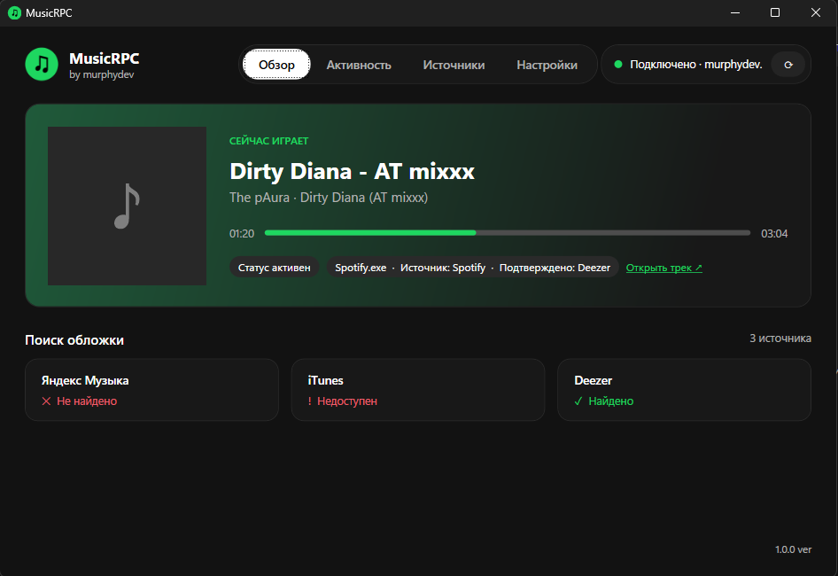
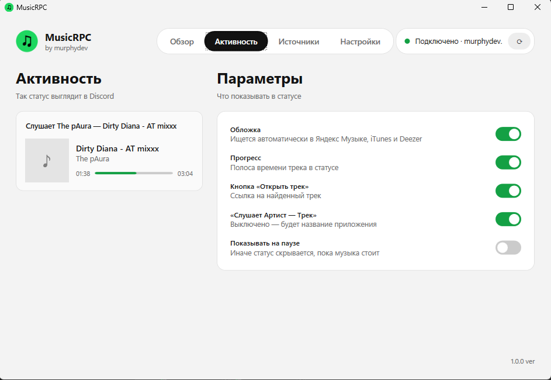
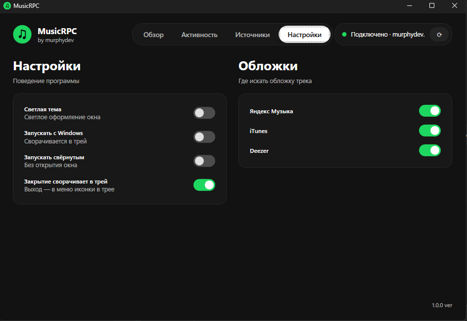

<div align="center">


# MusicRPC

**Показывай друзьям в Discord, что ты слушаешь прямо сейчас.**
Spotify · Яндекс Музыка · SoundCloud — с обложкой, прогрессом и кнопкой «Открыть трек».

[](https://github.com/uknwunworld/MusicRPC/releases/latest)
[](https://github.com/uknwunworld/MusicRPC/releases)
[](#установка)
[](LICENSE)

[**⬇ Скачать установщик**](https://github.com/uknwunworld/MusicRPC/releases/latest)



</div>

---

## ✨ Возможности

- 🎧 **Spotify, Яндекс Музыка, SoundCloud** — трек определяется автоматически, настраивать плееры не нужно.
- 🖼 **Правильная обложка.** Ищется в Яндекс Музыке, iTunes и Deezer; выбирается тот релиз, у которого совпали трек, *все* артисты и альбом. Чужая обложка из сборника не подставится — лучше без картинки, чем с неверной.
- ⚡ **Быстро.** Все источники опрашиваются параллельно, статус появляется в Discord уже сразу с обложкой.
- ⏱ **Прогресс и время** трека, пауза скрывает статус (по желанию — показывает).
- 🔗 **Кнопка «Открыть трек»** со ссылкой на найденный трек.
- 🌗 **Тёмная и светлая тема.**
- 🧰 **Живёт в трее**, умеет запускаться с Windows, не требует аккаунтов и токенов.
- 🔒 **Ничего не отправляет о вас.** Только название трека и артист уходят в публичные поиски обложек.

## 📸 Скриншоты

| Активность (светлая тема) | Настройки |
|---|---|
|  |  |

## 📦 Установка

1. Скачай **`MusicRPC-Setup-1.0.0.exe`** со страницы [Releases](https://github.com/uknwunworld/MusicRPC/releases/latest).
2. Запусти установщик (права администратора не нужны).
3. Открой Discord и включи музыку — статус появится сам.

> Установщик содержит всё необходимое, ставить .NET отдельно не нужно.
> Windows SmartScreen может предупредить о «неизвестном издателе» — у приложения пока нет платной подписи кода. Нажми **«Подробнее» → «Выполнить в любом случае»**.

**Требования:** Windows 10 (1903+) или Windows 11, десктопный Discord.

## 🎛 Как пользоваться

| Вкладка | Что делает |
|---|---|
| **Обзор** | Текущий трек, статус Discord и результат поиска обложки |
| **Активность** | Что показывать в статусе: обложка, прогресс, кнопка, «Слушает Артист — Трек», пауза |
| **Источники** | Какие плееры учитывать. Ниже — список медиа-сессий, которые видит Windows |
| **Настройки** | Светлая тема, автозапуск, сворачивание в трей, источники поиска обложек |

Закрытие окна сворачивает программу в трей — статус продолжает работать. Полный выход: правый клик по иконке в трее → **Выход**.

## ❓ Частые вопросы

<details>
<summary><b>Статус не появляется</b></summary>

- Discord должен быть запущен (десктопная версия, не браузер).
- В Discord: **Настройки → Конфиденциальность активности → «Показывать текущую активность в статусе»** — включить.
- Проверь вкладку **Источники**: плеер должен быть в списке сессий и включён переключателем.
- Нажми ⟳ в правом верхнем углу, чтобы переподключиться к Discord.
</details>

<details>
<summary><b>SoundCloud в браузере не определяется</b></summary>

SoundCloud опознаётся по заголовку окна браузера. Держи вкладку SoundCloud активной в момент старта трека. Если трек определился как «Браузер», включи **«Другие сайты в браузере»** на вкладке «Источники».
</details>

<details>
<summary><b>Нет обложки у трека</b></summary>

Обложка берётся только если релиз найден в Яндекс Музыке, iTunes или Deezer и совпал по названию трека, артистам и альбому. Если нигде нет такого же релиза — статус показывается без картинки, чтобы не вводить в заблуждение неверной обложкой.
</details>

<details>
<summary><b>iTunes показывает «Недоступен»</b></summary>

В ряде регионов Apple блокирует публичный поиск. Это нормально — остальные источники продолжают работать.
</details>

## 🛠 Сборка из исходников

Нужен [.NET 8 SDK](https://dotnet.microsoft.com/download/dotnet/8.0).

```bash
git clone https://github.com/uknwunworld/MusicRPC.git
cd MusicRPC
dotnet run
```

Единый самодостаточный exe:

```bash
dotnet publish -c Release -r win-x64 --self-contained true -p:PublishSingleFile=true -p:EnableCompressionInSingleFile=true -p:IncludeNativeLibrariesForSelfExtract=true -o publish
```

Установщик собирается в [Inno Setup 6](https://jrsoftware.org/isinfo.php):

```bash
iscc installer.iss
```

> Discord Application ID зашит в коде (`Models.cs` → `Settings.DefaultClientId`). Для форка создайте своё приложение на [Discord Developer Portal](https://discord.com/developers/applications) и замените значение.

## 🧩 Как это устроено

- **Захват трека** — системные медиа-сессии Windows (`GlobalSystemMediaTransportControlsSessionManager`), поэтому работает с любым плеером, который сообщает Windows о воспроизведении.
- **Discord** — собственная лёгкая реализация Rich Presence поверх локального IPC (`discord-ipc-*`), без сторонних библиотек.
- **Обложки** — публичные API Яндекс Музыки, iTunes и Deezer, оценка совпадения по названию, артистам и альбому.
- **Интерфейс** — WPF (.NET 8), темы через динамические ресурсы.

## 🗺 Планы

- [ ] Автообновление
- [ ] Отдельное оформление статуса для каждого сервиса
- [ ] Кнопки управления плеером в трее
- [ ] Отчёт об ошибках одной кнопкой
- [ ] Новые источники (VK Музыка, Apple Music, YouTube Music)

Идеи и баги — в [Issues](https://github.com/uknwunworld/MusicRPC/issues).

## 📄 Лицензия

[MIT](LICENSE) © murphydev

*MusicRPC — независимый проект и не связан со Spotify, Яндексом, SoundCloud или Discord. Все названия и товарные знаки принадлежат их владельцам.*

<div align="center">

**by murphydev**

</div>
