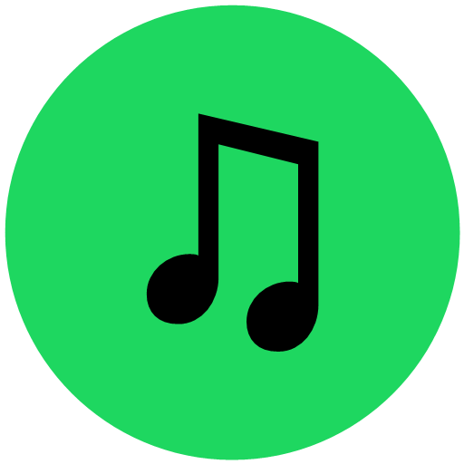
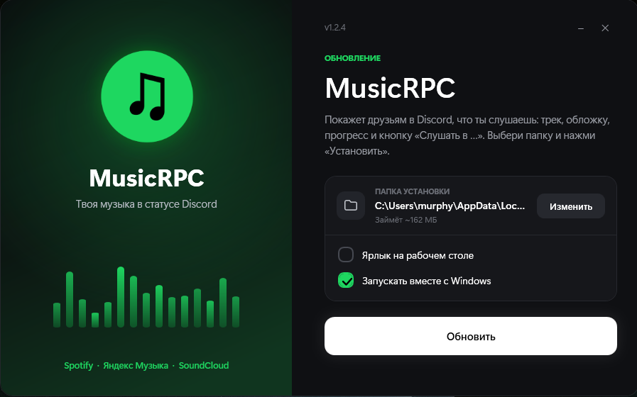
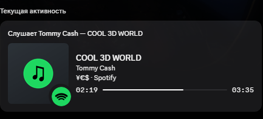
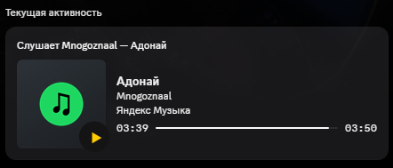
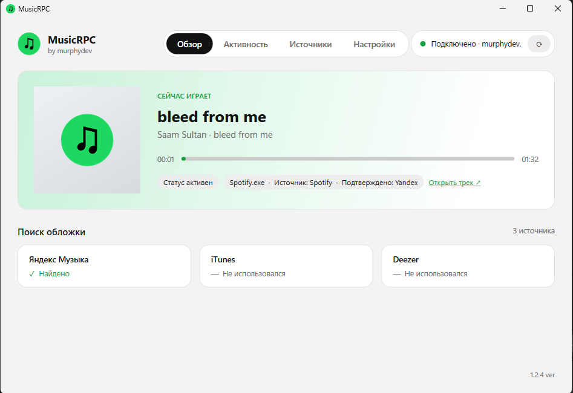
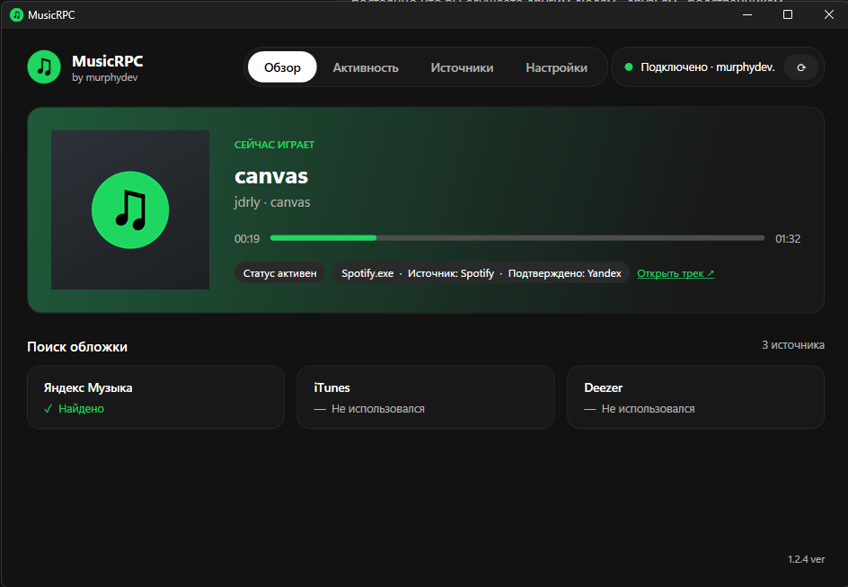
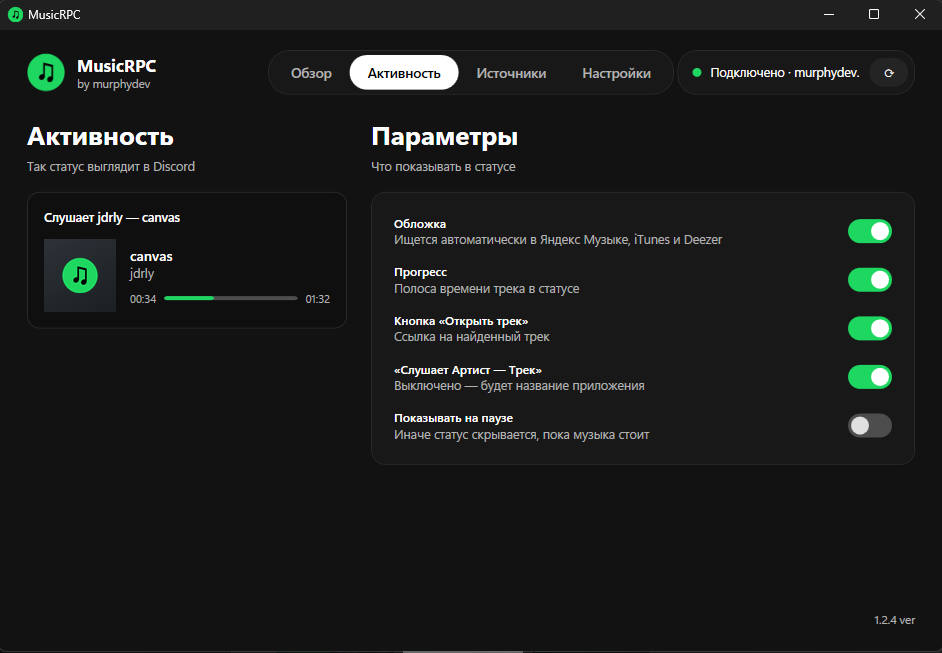
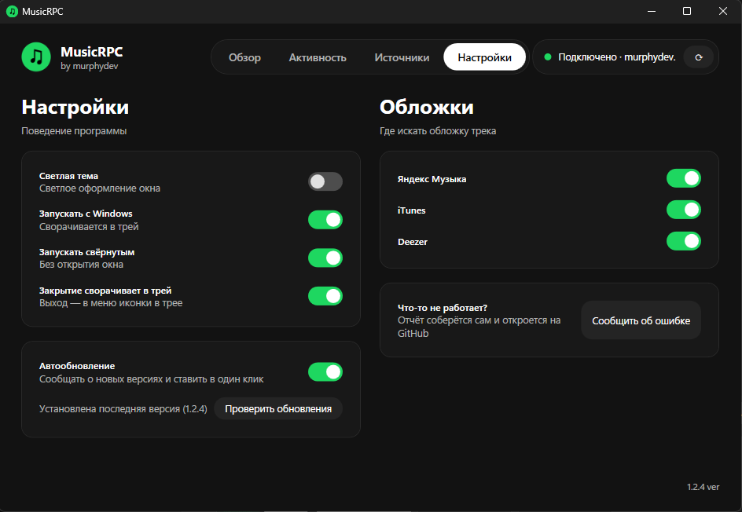
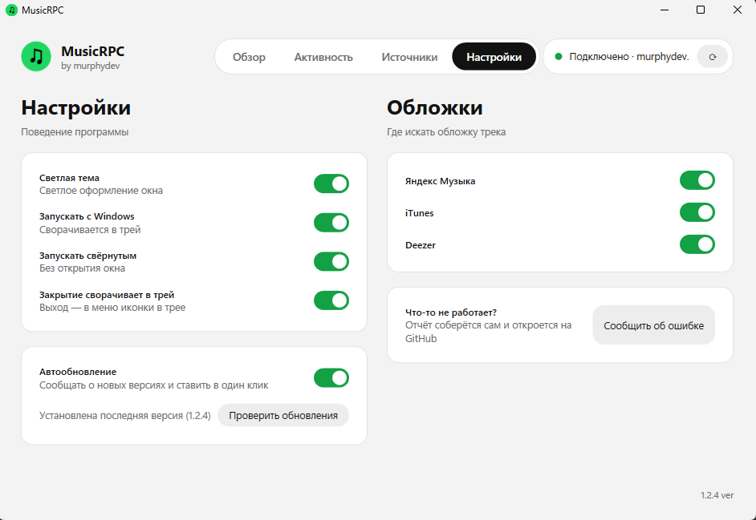

# MusicRPC

**Показывай друзьям и близким в Discord, что ты слушаешь — всегда и без лишних настроек.**
Spotify · Яндекс Музыка · SoundCloud — с обложкой, прогрессом и кнопкой «Слушать в …».

[**⬇ Скачать установщик**](https://github.com/uknwunworld/MusicRPC/releases/latest)

---

## 💡 Зачем это нужно

Родная интеграция Discord есть только у Spotify, и работает она не у всех: в России она не работает. Для Яндекс Музыки и SoundCloud встроенной интеграции нет вообще. **MusicRPC сделан именно для этого.**

Программа сама видит, что играет на твоём компьютере, и выставляет в Discord красивый статус «Слушает …»: с обложкой, прогрессом и кнопкой «Слушать в …». Без аккаунтов, токенов и подключений в настройках Discord.

- 👫 **Друзья** сразу видят, что ты слушаешь, и могут зайти послушать то же самое.
- 👨‍👩‍👧 **Родные и близкие** знают, чем ты живёшь: чужой плейлист говорит о настроении лучше любых слов.
- 🔁 **Всегда в курсе.** Статус обновляется сам, пока играет музыка, и пропадает, когда ты ставишь паузу.

Поставил, включил музыку, и всё: больше ничего настраивать не нужно.

---

## ✨ Возможности

- 🎧 **Spotify, Яндекс Музыка, SoundCloud** — трек и сервис определяются автоматически, даже если вкладка с музыкой в фоне. На обложке значок сервиса.
- 🖼 **Правильная обложка.** Ищется в Яндекс Музыке, iTunes и Deezer; выбирается тот релиз, у которого совпали трек, *все* артисты и альбом. Чужая обложка из сборника не подставится — лучше без картинки, чем с неверной.
- ⚡ **Быстро.** Все источники опрашиваются параллельно, статус появляется в Discord уже сразу с обложкой.
- ⏱ **Прогресс и время** трека, пауза скрывает статус (по желанию — показывает).
- 🔗 **Кнопка со ссылкой на трек** — у каждого сервиса своя: «Слушать в Spotify», «Слушать в Яндекс Музыке», «Слушать в SoundCloud».
- 🌗 **Тёмная и светлая тема.**
- 🔄 **Автообновление.** Программа сама проверяет новые версии на GitHub и ставит их в один клик: скачивает, проверяет контрольную сумму, обновляется и перезапускается.
- 🧰 **Живёт в трее**, умеет запускаться с Windows, не требует аккаунтов и токенов.
- 🔒 **Ничего не отправляет о вас.** Только название трека и артист уходят в публичные поиски обложек.

## 📸 Скриншоты

**Так выглядит статус в Discord:**

| Spotify | Яндекс Музыка |
|---|---|
|  |  |

**Окно программы — обзор:**

| Светлая тема | Тёмная тема |
|---|---|
|  |  |

**Выбор активности — что показывать в статусе:**

**Настройки:**

| Тёмная тема | Светлая тема |
|---|---|
|  |  |

## 📦 Установка

1. Скачай **`MusicRPC-Setup-<версия>.exe`** со страницы [Releases](https://github.com/uknwunworld/MusicRPC/releases/latest).
2. Запусти установщик (права администратора не нужны).
3. Открой Discord и включи музыку — статус появится сам.

> Установщик содержит всё необходимое, ставить .NET отдельно не нужно.
> Windows SmartScreen может предупредить о «неизвестном издателе» — у приложения пока нет платной подписи кода. Нажми **«Подробнее» → «Выполнить в любом случае»**.

**Требования:** Windows 10 (1903+) или Windows 11, десктопный Discord.

## 🎛 Как пользоваться

| Вкладка | Что делает |
|---|---|
| **Обзор** | Текущий трек, статус Discord и результат поиска обложки |
| **Активность** | Что показывать в статусе: обложка, прогресс, кнопка, «Слушает Артист — Трек», пауза |
| **Источники** | Какие плееры учитывать. Ниже — список медиа-сессий, которые видит Windows |
| **Настройки** | Светлая тема, автозапуск, сворачивание в трей, автообновление, источники поиска обложек |

Закрытие окна сворачивает программу в трей — статус продолжает работать. Полный выход: правый клик по иконке в трее → **Выход**.

## ❓ Частые вопросы

<b>Статус не появляется</b>

- Discord должен быть запущен (десктопная версия, не браузер).
- В Discord: **Настройки → Конфиденциальность активности → «Показывать текущую активность в статусе»** — включить.
- Проверь вкладку **Источники**: плеер должен быть в списке сессий и включён переключателем.
- Нажми ⟳ в правом верхнем углу, чтобы переподключиться к Discord.

<b>SoundCloud в браузере не определяется</b>

SoundCloud опознаётся по названию вкладки браузера (Chrome, Edge, Firefox и другие), в том числе когда вкладка в фоне. Если трек всё равно определился как «Браузер», включи **«Другие сайты в браузере»** на вкладке «Источники».

<b>Нет обложки у трека</b>

Обложка берётся только если релиз найден в Яндекс Музыке, iTunes или Deezer и совпал по названию трека, артистам и альбому. Если нигде нет такого же релиза — статус показывается без картинки, чтобы не вводить в заблуждение неверной обложкой.

<b>iTunes показывает «Недоступен»</b>

В ряде регионов Apple блокирует публичный поиск. Это нормально — остальные источники продолжают работать.

## 🧩 Как это устроено

- **Захват трека** — системные медиа-сессии Windows (`GlobalSystemMediaTransportControlsSessionManager`), поэтому работает с любым плеером, который сообщает Windows о воспроизведении.
- **Discord** — собственная лёгкая реализация Rich Presence поверх локального IPC (`discord-ipc-*`), без сторонних библиотек.
- **Обложки** — публичные API Яндекс Музыки, iTunes и Deezer, оценка совпадения по названию, артистам и альбому.
- **Интерфейс** — WPF (.NET 8), темы через динамические ресурсы.

## 🗺 Планы

- [x] Автообновление
- [x] Отдельное оформление статуса для каждого сервиса
- [ ] Кнопки управления плеером в трее
- [x] Отчёт об ошибках одной кнопкой
- [ ] Новые источники (VK Музыка, Apple Music, YouTube Music)

Идеи и баги — в [Issues](https://github.com/uknwunworld/MusicRPC/issues).

## 📄 Лицензия

[MIT](LICENSE) © murphydev

*MusicRPC — независимый проект и не связан со Spotify, Яндексом, SoundCloud или Discord. Все названия и товарные знаки принадлежат их владельцам.*

**by murphydev**

