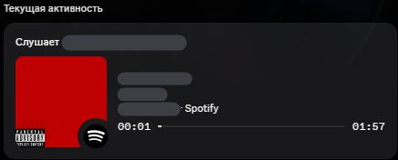
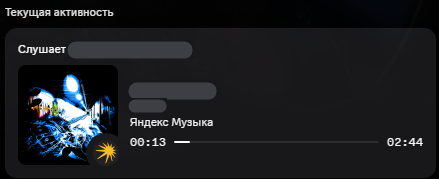

# MusicRPC

**Показывай друзьям и близким в Discord, что ты слушаешь — всегда и без лишних настроек.**

Spotify · Яндекс Музыка · SoundCloud — с обложкой, прогрессом и кнопкой «Слушать в …»

 

[**⬇ Скачать установщик**](https://github.com/uknwunworld/MusicRPC/releases/latest)

[Зачем это нужно](#-зачем-это-нужно) · [Возможности](#-возможности) · [Скриншоты](#-скриншоты) · [Установка](#-установка) · [Вопросы](#-частые-вопросы) · [Приватность](#-приватность) · [История версий](CHANGELOG.md)

---

## 💡 Зачем это нужно

Родная интеграция Discord есть только у Spotify, и работает она не у всех: в России она не работает. Для Яндекс Музыки и SoundCloud встроенной интеграции нет вообще. **MusicRPC сделан именно для этого.**

Программа сама видит, что играет на твоём компьютере, и выставляет в Discord красивый статус «Слушает …»: с обложкой, прогрессом и кнопкой «Слушать в …». Без аккаунтов, токенов и подключений в настройках Discord.

- 👫 **Друзья** сразу видят, что ты слушаешь, и могут зайти послушать то же самое.
- 👨‍👩‍👧 **Родные и близкие** знают, чем ты живёшь: чужой плейлист говорит о настроении лучше любых слов.
- 🔁 **Всегда в курсе.** Статус обновляется сам, пока играет музыка, и пропадает, когда ты ставишь паузу.

Поставил, включил музыку, и всё: больше ничего настраивать не нужно.

---

## ✨ Возможности

| | |
|---|---|
| 🎧 **Три сервиса из коробки** | Spotify, Яндекс Музыка и SoundCloud определяются автоматически — даже если вкладка с музыкой в браузере в фоне. На обложке значок сервиса. |
| 🖼 **Правильная обложка** | Ищется в Яндекс Музыке, iTunes, Deezer, а если там нет — в MusicBrainz. Выбирается тот релиз, у которого совпали трек, *все* артисты и альбом: чужая обложка из сборника не подставится. |
| ⏱ **Прогресс и время** | Полоса прогресса в статусе. Пауза скрывает статус (по желанию — показывает). |
| 🔗 **Своя кнопка у каждого сервиса** | «Слушать в Spotify», «Слушать в Яндекс Музыке», «Слушать в SoundCloud». |
| 🌗 **Тёмная и светлая тема** | Окно программы подстраивается под твой вкус. |
| 🔄 **Автообновление** | Программа сама проверяет новые версии на GitHub и ставит их в один клик: скачивает, сверяет контрольную сумму, обновляется и перезапускается. |
| 🧰 **Живёт в трее** | Запускается с Windows, сворачивается без лишнего шума, не требует аккаунтов и токенов. |
| 🐞 **Отчёт об ошибке одной кнопкой** | Собирает технический отчёт без названий треков и открывает заготовку issue. Ничего не отправляется автоматически. |

---

## 📸 Скриншоты

**Так выглядит статус в Discord:**

| Spotify | Яндекс Музыка |
|---|---|
|  |  |

**Окно программы — обзор:**

| Светлая тема | Тёмная тема |
|---|---|
|  |  |

**Выбор активности — что показывать в статусе:**

**Настройки:**

| Тёмная тема | Светлая тема |
|---|---|
|  |  |

---

## 📦 Установка

1. Скачай **`MusicRPC-Setup-<версия>.exe`** со страницы [Releases](https://github.com/uknwunworld/MusicRPC/releases/latest).
2. Запусти установщик, выбери папку и нажми **«Установить»** (права администратора не нужны).
3. Открой Discord и включи музыку — статус появится сам.

> Установщик содержит всё необходимое, ставить .NET отдельно не нужно.
> Windows SmartScreen может предупредить о «неизвестном издателе» — у приложения пока нет платной подписи кода. Нажми **«Подробнее» → «Выполнить в любом случае»**.

**Обновление.** Программа сама предложит новую версию. Или запусти новый установщик поверх старой установки — настройки сохранятся.
**Удаление.** Параметры Windows → Приложения → MusicRPC → Удалить.
**Требования.** Windows 10 (1903+) или Windows 11, десктопный Discord.

---

## 🎛 Как пользоваться

| Вкладка | Что делает |
|---|---|
| **Обзор** | Текущий трек, статус Discord и результат поиска обложки |
| **Активность** | Что показывать в статусе: обложка, прогресс, кнопка, «Слушает Артист — Трек», пауза |
| **Источники** | Какие плееры учитывать. Ниже — список медиа-сессий, которые видит Windows |
| **Настройки** | Светлая тема, автозапуск, сворачивание в трей, автообновление, источники поиска обложек |

Закрытие окна сворачивает программу в трей — статус продолжает работать. Полный выход: правый клик по иконке в трее → **Выход**.

---

## ❓ Частые вопросы

<b>Статус не появляется</b>

- Discord должен быть запущен (десктопная версия, не браузер).
- В Discord: **Настройки → Конфиденциальность активности → «Показывать текущую активность в статусе»** — включить.
- Проверь вкладку **Источники**: плеер должен быть в списке сессий и включён переключателем.
- Нажми ⟳ в правом верхнем углу, чтобы переподключиться к Discord.

<b>SoundCloud в браузере не определяется</b>

SoundCloud опознаётся по названию вкладки браузера (Chrome, Edge, Firefox и другие), в том числе когда вкладка в фоне. Если трек всё равно определился как «Браузер», включи **«Другие сайты в браузере»** на вкладке «Источники».

<b>Нет обложки у трека</b>

Обложка берётся только если релиз найден в одной из баз (Яндекс Музыка, iTunes, Deezer, MusicBrainz) и совпал по названию трека и артистам. У совсем новых или редких релизов её может не быть нигде — тогда в статусе показывается логотип MusicRPC, а значок сервиса остаётся внизу справа.

<b>iTunes и Deezer показывают «Недоступен» или «403»</b>

В ряде регионов (в том числе в России) эти сервисы закрывают публичный поиск. Это нормально — остальные источники продолжают работать.

<b>Обложки перестали находиться, хотя интернет есть</b>

Если в Windows прописан прокси, а сам прокси-клиент (VPN) выключен, запросы в него упираются в «подключение отвергнуто». Программа в этом случае сама повторяет запрос напрямую. Если обложки всё равно нет, нажми в «Настройках» **«Сообщить об ошибке»** — отчёт поможет разобраться.

---

## 🔒 Приватность

MusicRPC не требует аккаунтов, паролей и токенов, ничего не собирает о тебе и не отправляет автоматически. Вот что и куда уходит:

| Что | Куда | Зачем |
|---|---|---|
| Название трека, артист, альбом | Яндекс Музыка, iTunes, Deezer, MusicBrainz / Cover Art Archive | Найти обложку и ссылку |
| Тот же статус (трек, обложка, время) | Твой локальный Discord | Показать друзьям |
| Запрос версии и скачивание обновления | GitHub Releases | Автообновление (можно выключить) |

Отчёт об ошибке собирается локально, копируется в буфер обмена и открывается в браузере как заготовка issue — ты видишь его до отправки.

---

## 🧩 Как это устроено

- **Захват трека** — системные медиа-сессии Windows (`GlobalSystemMediaTransportControlsSessionManager`), поэтому работает с любым плеером, который сообщает Windows о воспроизведении.
- **Определение сервиса** — по идентификатору плеера и по названиям вкладок браузера (UI Automation).
- **Discord** — собственная лёгкая реализация Rich Presence поверх локального IPC (`discord-ipc-*`), без сторонних библиотек.
- **Обложки** — публичные API Яндекс Музыки, iTunes и Deezer, запасной источник — MusicBrainz и Cover Art Archive. Совпадение оценивается по названию, артистам и альбому.
- **Интерфейс** — WPF (.NET 8), темы через динамические ресурсы.
- **Установщик** — собственный, на WPF (.NET Framework 4.8, есть в Windows 10/11), поэтому сам маленький и ничего не требует.

---

## 🗺 Планы

- [x] Автообновление
- [x] Отдельное оформление статуса для каждого сервиса
- [x] Отчёт об ошибках одной кнопкой
- [x] Фирменный установщик
- [ ] Кнопки управления плеером в трее
- [ ] Новые источники (VK Музыка, Apple Music, YouTube Music)

Идеи и баги — в [Issues](https://github.com/uknwunworld/MusicRPC/issues). Список изменений по версиям — в [CHANGELOG](CHANGELOG.md).

---

## 📄 Лицензия

[MIT](LICENSE) © murphydev

*MusicRPC — независимый проект и не связан со Spotify, Яндексом, SoundCloud или Discord. Все названия и товарные знаки принадлежат их владельцам.*

**by murphydev**

